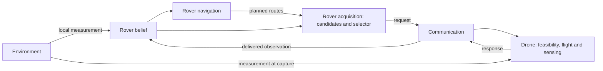

# SCOUT logical components

Target clarification (2026-11-14): [information needs and helper
proposals](SCOUT_INFORMATION_REQUESTS.md) separates the rover's question region
from the drone's measurement pose. The drone should assess usefulness and
propose execution, while the rover compares offers against no query. This is
the target direction, not implemented behavior. The mappings below describe
the current pilot; its single-point candidate generator predates that split.

Recorded 2026-11-14. These are logical responsibilities, not six newly
implemented classes. Current code implements the services but wires several
agent responsibilities in the simulation loop. Complete rover/drone autonomy
containers are not implemented yet.

## Environment

Owns the real terrain and physical constraints. The generator creates this
truth and a separate public initial prior. The truth is not the rover's map.
Current mapping: `environments/grid.py`, `environments/corridors.py`.

Sensor configuration belongs to the robot. The simulated sensor model executes
against the environment at capture time and produces noisy evidence. The robot
receives that evidence, not the environment object. Mapping: `sensors/`.

## Rover agent

Logically owns its pose, goal, sensors, received observations and decision state:

| Internal component | Responsibility | Current mapping |
|---|---|---|
| Motion state | Track own pose and pending movement | `agents/rover.py` |
| Belief updater | Fuse received observations and contact evidence into local occupancy probabilities | `belief/occupancy.py` |
| Navigation planner | Select a route using local belief | `planning/grid.py` |
| Acquisition candidate generator | Propose useful observation targets from local belief and routes | `decision/acquisition/candidates.py` |
| Acquisition selector | Choose an observation or no new request | Online baselines: `no_scouting.py`, `uncertainty.py`; learned candidate selector not implemented |
| Messaging interface | Request helper observations and receive responses | Currently wired in `simulation/mission.py`, not a complete agent messaging API |

In the current pilot, candidate generation and selection describe rover-side
choices. In the clarified target, the rover selects information needs and
offers; the drone generates execution/viewpoint proposals. Both must use local
knowledge and explicitly received context, never real terrain, simulator forks
or offline scores. Navigation and acquisition remain separate.

## Drone agent

Owns its local pose, motion/sensor parameters and availability. Checks whether
an observation request is feasible, executes it, and returns a measurement.
Mapping: `agents/drone.py`, plus sensor capture scheduled by the simulator.

The current drone has no independent science-goal selection or terrain belief.
It responds to observation requests. This is not yet symmetric fleet planning.
The target adds recipient-usefulness assessment, execution proposals and refusal
beyond the existing physical feasibility check; see the linked design note.

## Communication

Carries requests, status and observation responses across agent boundaries.
The intended interface identifies sender, recipient, requested target, capture
time, delivery time and payload identity/size.

Current code (`communication/delayed.py`) models delayed responses and payload
sizes, using the simulation event queue. Request acceptance is immediate;
request/ACK delay, losses and traffic are not implemented. The intended logical
protocol must not be described as a completed transport implementation.

## Simulation engine

Owns time, event order, physical execution and resource accounting. Executes
movement, sensor capture and message delivery. Mapping: `simulation/mission.py`,
`simulation/events.py`, `costs/mission.py`.

The pilot currently invokes sensing, belief updates and policies inside this
loop. That wiring does not give policies the engine's full knowledge: they
receive only the immutable local `DecisionView` and belief-derived route.

## Experiment and offline laboratory

Owns scenario configuration, seeds, initial goals/budgets, selected methods,
comparisons, provenance and reports. Mapping: `experiments/scout/`,
`simulation/config.py`, `cli/scout.py`, `evaluation/mission.py`.

The counterfactual evaluator may fork full simulator state and inspect true
outcomes to create supervision. These realized gains are training targets,
not knowledge available to the rover. A future online selector must predict
value or plan from permitted beliefs, without querying the hidden-world oracle.

## Decision flow

The simulation clock drives execution of this flow. Offline evaluation is
outside the operational decision loop.

## Next ownership refactor

Introduce a rover agent container composing its belief, navigation and
acquisition services. Preserve decision inputs, event ordering and outcomes.
Keep real terrain and counterfactual access outside that object. Extend the
helper protocol only when required by the next experiment.
